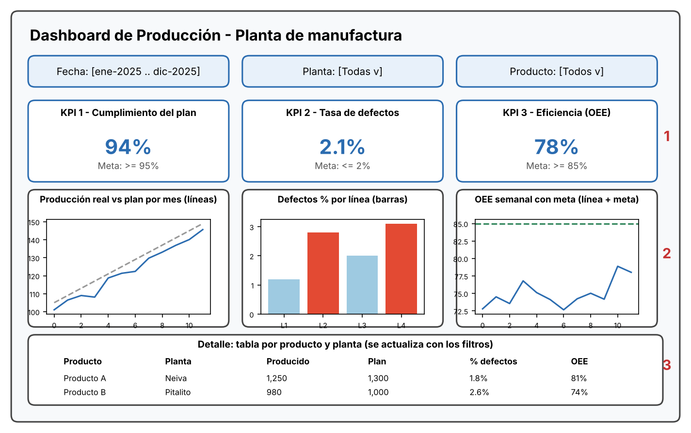

# Semana 13 — Diseña un dashboard

**Autor:** FULL_NAME · **GitHub:** carolinagomezsuache-alt

## Proceso elegido
**Producción** en una planta de manufactura (Ingeniería Industrial).

## KPIs y objetivo

| # | KPI | Fórmula | Objetivo | Por qué importa |
|---|---|---|---|---|
| 1 | **Cumplimiento del plan** | Unidades producidas / Unidades planeadas × 100 | ≥ 95 % | Indica si la planta entrega lo comprometido |
| 2 | **Tasa de defectos** | Unidades defectuosas / Unidades producidas × 100 | ≤ 2 % | Mide calidad y costos de reproceso |
| 3 | **Eficiencia global (OEE)** | Disponibilidad × Rendimiento × Calidad | ≥ 85 % | Resume qué tan bien se usa la capacidad instalada |

## Boceto del dashboard

> Los valores del boceto son ilustrativos; sirven para mostrar la estructura, no son datos reales.

## Gráfico asignado a cada KPI

| KPI | Gráfico | Razón |
|---|---|---|
| Cumplimiento del plan | Líneas: producción real vs plan por mes | Muestra evolución en el tiempo y la brecha frente a la meta |
| Tasa de defectos | Barras por línea de producción (resalta las que superan 2 %) | Compara categorías y señala dónde actuar |
| OEE | Línea semanal con línea de meta en 85 % | Permite ver tendencia y si se alcanza la meta |

## Filtros
- **Fecha** (rango de meses o semanas)
- **Planta** (por ejemplo, Neiva y Pitalito)
- **Producto**

Los filtros afectan a todas las tarjetas, gráficos y la tabla, para que el análisis sea consistente.

## Jerarquía visual (qué va arriba y por qué)
1. **Arriba: filtros y las 3 tarjetas de KPI.** Es lo primero que se lee (de arriba hacia abajo y de izquierda a derecha). Con números grandes y la meta al lado, el usuario sabe en segundos si el proceso va bien o mal.
2. **En medio: un gráfico por KPI, alineado con su tarjeta.** Explica el "por qué" del número: tendencia, comparación por línea y evolución frente a la meta.
3. **Abajo: tabla de detalle por producto y planta.** Es información para profundizar; solo se consulta cuando un KPI alerta, por eso va al final.

Se usa un solo color de acento para lo normal y rojo solo para lo que incumple la meta, para que la atención vaya a los problemas.
