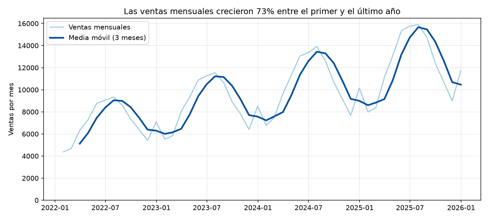
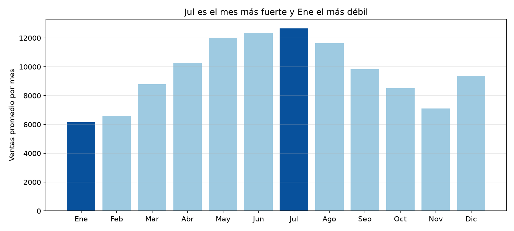

# c3-activity — Análisis temporal y visualización

**Autor:** FULL_NAME · **GitHub:** GITHUB_USER

## Contenido
| Archivo | Descripción |
|---|---|
| `analisis_temporal.py` | Serie temporal con `resample` mensual y media móvil de 3 meses |
| `evolucion.png` | Visualización 1 (evolución) |
| `comparacion.png` | Visualización 2 (comparación por mes) |
| `consulta_optimizada.sql` | Consulta SQL antes/después con explicación de la mejora |

## Serie temporal
Las ventas diarias se agregan por mes con `resample("ME").sum()` y se suaviza con una media móvil de 3 meses. La **tendencia** es creciente (~141 unidades más por mes; +73% entre el primer y el último año). La **estacionalidad** es marcada: el pico promedio ocurre en julio y el valle en enero.

## Optimización SQL
Se reemplazó `WHERE YEAR(fecha) = 2025` por un filtro de rango sobre `fecha`, se creó un índice y se seleccionaron solo las columnas necesarias. Así se evita el full scan. Ver `consulta_optimizada.sql`.

## Findings
The monthly sales series, built with `resample` and a 3-month moving average, shows a clear upward trend over the four years analyzed. Sales in the last year are about 73% higher than in the first year. The moving average smooths short-term noise and makes this sustained growth easier to see. The data also shows strong seasonality, with the highest average sales in July and the lowest in January. The line chart shows monthly sales over time compared with their moving average, while the bar chart compares the average sales of each calendar month and highlights the seasonal peak and dip.

> Nota: los datos de ejemplo son sintéticos; si usas tu propio `datos.csv` (columnas `fecha`, `ventas`), vuelve a ejecutar el script y actualiza las cifras de esta sección.
